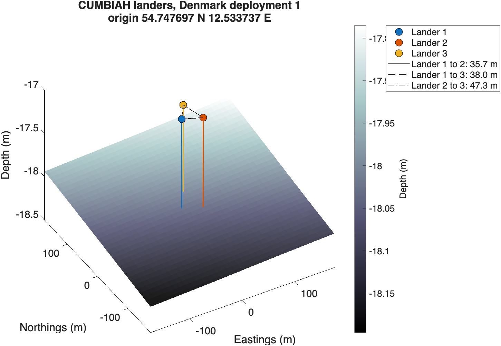
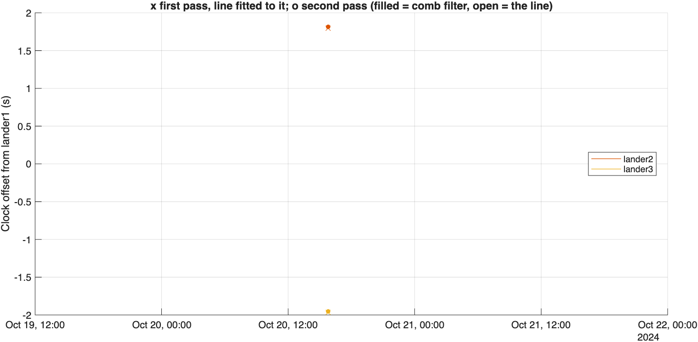
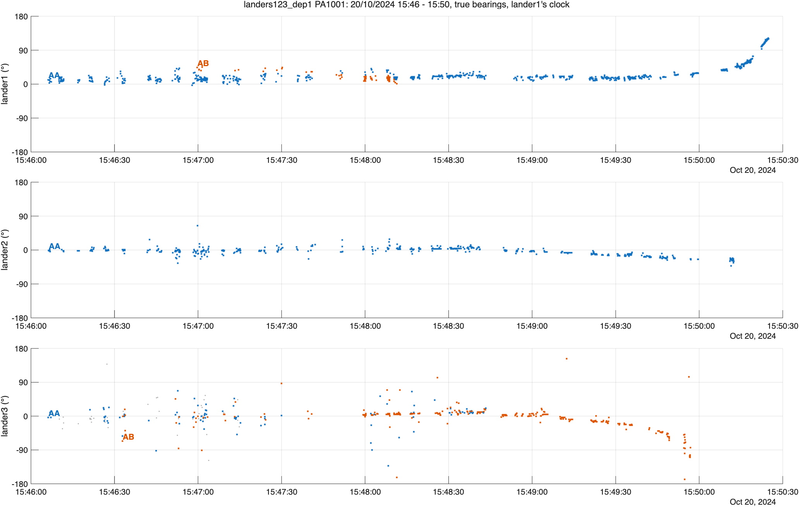
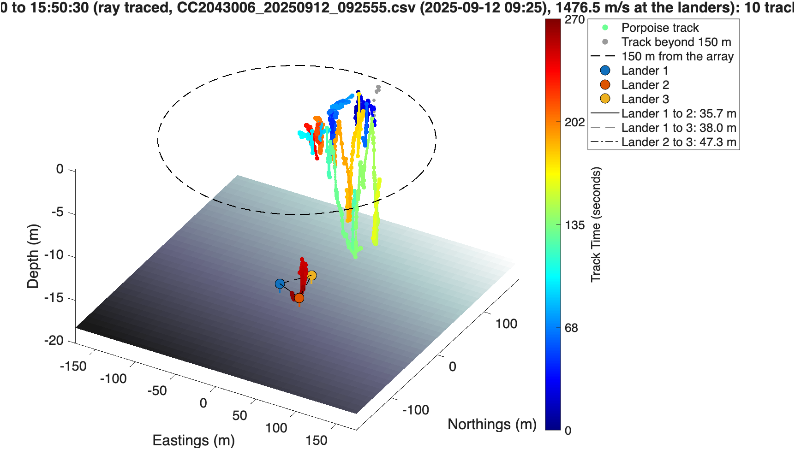
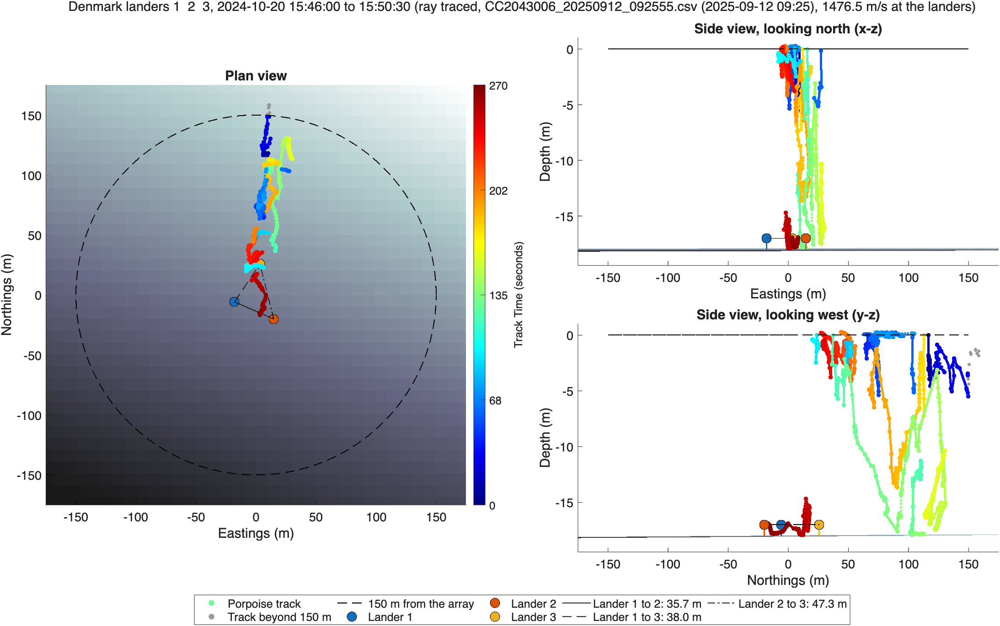
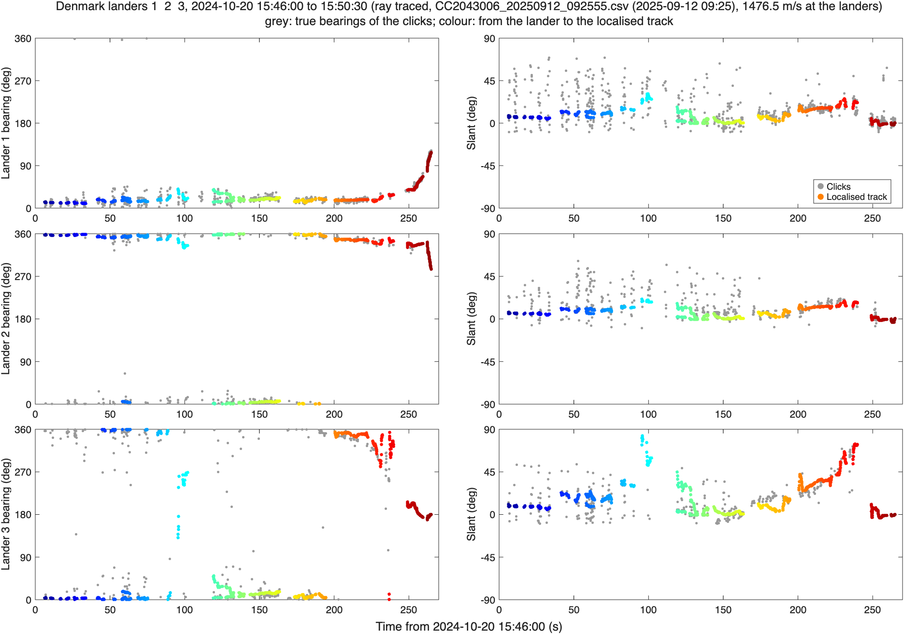
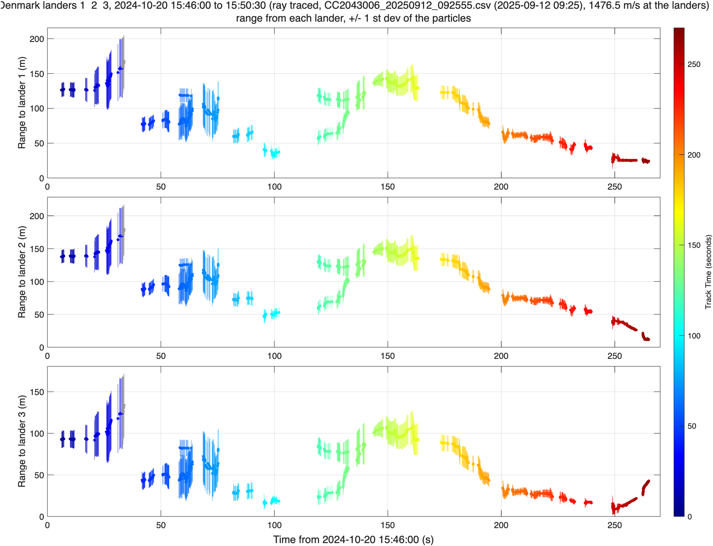

::: {.callout-note appearance="simple"}
|  |  |
|------------------------------------|------------------------------------|
| **MATLAB library** | [`cumbiah_landers_mat`](https://github.com/CUMBIAH/cumbiah_landers_mat) |
| **Scripts used** | `localise_porpoises/localise_porpoises.m`, `localise_porpoises/localiseporpoises.m` |
| **Test script** | `localise_porpoises/_test/test_localise_one_event.m` |
| **Worked example** | Denmark, landers 1--3, deployment 1 (Oct 24), 20 October 2024 15:46:00--15:50:30 |
| **Output** | `<name>_loctracks.mat`, struct array `loctracks` |
:::

<!--
  YOUTUBE VIDEO PLACEHOLDER
  This is for the tutorial video (not the dive track movie, which is embedded
  in @sec-movie). Replace the callout below with the Quarto video shortcode and
  the YouTube link of the tutorial video, written the same way as on the other
  tutorial pages, e.g.  video https://www.youtube.com/watch?v=<VIDEO_ID>
  inside .
-->

::: {.callout-important}
## Video placeholder
The tutorial video goes here once it is on YouTube. The movie of the worked example's dive tracks is in @sec-movie.
:::

# Pre-requisites {#sec-prereq}

## Data

From the earlier tutorials you need, for every lander of the array:

-   The lander locations and orientations, `lander_array_locations_dep<N>.mat`, and the seabed around the array, `bathymetry/lander_array_bathymetry_dep<N>.mat`, from [Locating the Landers](locatelanders.qmd).
-   Click trains from single animals in each lander's porpoise database (`..._porpoise.sqlite3`): the checked `pp` events from [Automatic Porpoise Bearing Tracks](multitrack.qmd), or click trains marked by hand in [Tracking Porpoises with PAMGuard](pamguard.qmd#sec-annotating). Both are in the same format: one `pp` event per animal.
-   The boat calibration trials marked as `bc` events ([Locating the Landers](locatelanders.qmd#sec-pamguard)), so the cavitation transients are not mistaken for porpoises.
-   *Optional:* the propagation lookup tables, `propagation/propagation_tables.mat`, from [Propagation](propagation.qmd), to allow for refraction. Without them sound is assumed to travel in straight lines at a single sound speed.

As in the other tutorials, each lander is described by the deployment record of `getlanderdeploymentinfo` and `getlanderpaths` ([Locating the Landers](locatelanders.qmd#data-management)). `localiseporpoises` needs its `landernumber`, `deployment`, `startTime`, `endTime` and `porpoisedB` (the track database).

## Software

| Requirement | What it is needed for |
|----------------------|--------------------------------------------------|
| [`cumbiah_landers_mat`](https://github.com/CUMBIAH/cumbiah_landers_mat), with the `localise_porpoises` and `propagation` folders | The scripts, `localiseporpoises` and the plot functions in `localise_porpoises/plot` |
| [soundnetloc_mat](https://github.com/Sound-Net/soundnetloc_mat) | `load_event_clicks` (reading the clicks of the tracks), `read_pamguard_hydrophones`, `latLong2meters`, `getsuperfolder` and `getdefaultcols` in `utils`; `partice_filter_pam` and `trackstartloc_bounded` in `locate_animals/particle_filter_loc`; `associate_tracks` in `click_train_tracking`; `find_time_offset` in `clock` |
| [PAMGuardMatlab](https://github.com/PAMGuard/PAMGuardMatlab) | Reading the clicks out of the PAMGuard binary store |
| MATLAB **Database Toolbox** | `sqlite`, used to read the tracks from the PAMGuard databases |
| MATLAB **Statistics and Machine Learning Toolbox** | `normrnd` and `randsample`, used by the particle filter |

# Introduction

By this point in the workflow every lander has been located and oriented on the seabed ([Locating the Landers](locatelanders.qmd)) and the porpoise clicks it heard have been grouped into click trains, one per animal ([Automatic Porpoise Bearing Tracks](multitrack.qmd)). Each lander on its own only gives the *direction* of a porpoise: a horizontal bearing and a slant angle to every click. To get a position we need the same animal on at least two landers, so that the directions can be crossed.

That sounds simple, but there are three problems to solve first:

1.  **Which tracks are the same animal?** The click trains of each lander were made independently, so the tracks have to be *matched* between the landers.
2.  **The clocks do not agree.** Each lander has its own clock, and they drift apart by about a second a week. A second is a long time for a porpoise clicking ten times a second, so the clocks have to be lined up before the clicks of the two landers can be paired.
3.  **Porpoise bearings are noisy.** Porpoise clicks are narrow band, high frequency and directional, so single click bearings scatter by several degrees. Crossing two noisy bearings click by click gives very scattered positions. Instead a **particle filter** follows each animal through time with a simple model of how a porpoise can move, which smooths out the noise and gives an estimate of the error at every point.

`localiseporpoises` does all of this. The workflow is:

```{mermaid}
%%| fig-align: center
flowchart LR
  A[("Lander track<br/>databases")] --> E["Array encounters"]
  E --> C["Line up the clocks<br/>(comb filter)"]
  C --> M["Match the tracks<br/>between landers"]
  M --> F["Break into<br/>fragments"]
  F --> S["Start location"]
  S --> P["Particle filter<br/>(nruns × particles)"]
  L[("Lander locations<br/>and orientations")] --> P
  R[("Propagation<br/>tables")] -.-> P
  P --> O[("loctracks.mat")]
```

This tutorial covers:

-   how the matching, clocks and localisation work (@sec-how);
-   running a whole deployment with `localise_porpoises.m` (@sec-running);
-   a worked example of one event, with the plots used to check it (@sec-example);
-   what is saved (@sec-output).

# How it works {#sec-how}

## Tracks and encounters

The tracks are read back from each lander's porpoise database, so anything changed by hand in the PAMGuard viewer is used. Every `pp` event that starts inside the lander's deployment is a track. Tracks during a boat calibration trial (a `bc` event in any of the landers' databases, plus `boatpad` minutes either side) are the boat, not porpoises, and are left out.

The bearings of each click are turned from the lander's frame into true bearings with the heading, pitch and roll of [Locating the Landers](locatelanders.qmd). The landers are on the seabed so nothing real arrives from well below them: clicks with a true slant angle below `minslant` (−10° by default) are reflections or bad time delays and are dropped.

An **array encounter** is a run of tracks, on any of the landers, with no gap of more than `encountergap` minutes (5 by default). Only encounters with tracks on two or more landers can be localised. They are numbered in time order and coded `PA<deployment><nnn>`, e.g. `PA1003`: PA rather than PP because they belong to the array, not one lander.

## Lining up the clocks {#sec-clocks}

The clocks of the landers are lined up with a **comb filter**. For a pair of landers, every click time on one is subtracted from every click time on the other, within a window of possible offsets. If the two landers heard the same clicks, the differences pile up at the true clock offset (give or take the travel time between them), as a peak above a flat background.

With three landers there are three pairs but only two unknown clocks (the first lander is the reference), so the offsets are fitted to all the pairs with a clear peak -- at least `mincombpeak` click pairs and `mincombsnr` times the background. The clocks start together and drift slowly, so the search is done in two passes over every encounter of the deployment:

1.  In time order, the offset is searched for within `maxoffset` (5 s) of the last one found. A straight line (Theil-Sen, so robust to the odd wrong peak) is then fitted to offset against time for each lander.
2.  The offset is searched for again within `maxresidual` (0.25 s) of that line. An encounter with no clear peak is given the offset of the line.

The clock plot (`<name>_clock.png`) shows both passes and the line for every lander through the deployment, and is the first thing to check after a run.

::: callout-note
The particle filter only uses the time delays *within* each lander (between its four hydrophones), not the arrival time differences *between* landers. The clocks therefore only have to be good enough to pair the clicks and put them in the right order -- tens of milliseconds, not microseconds.
:::

## Matching the tracks between landers {#sec-matching}

Each pair of landers is matched with `associate_tracks`. Two tracks can be the same animal if

-   their heading bearings cross, within `maxRange` (500 m) of the landers, for at least `crossFrac` of the time they overlap; and
-   their click times line up: a click on one lander has a partner on the other within the travel time across the array.

Anything still ambiguous (two tracks on lander 2 that could both be the animal on lander 1) is settled by the Hungarian algorithm. Tracks joined through any pair are one animal, so an animal can be heard on two landers or on all three. Each animal is lettered in time order: `PA1003AB` is the second animal of encounter `PA1003`.

The association plot of each encounter (`<name>_PAnnnn_association.png`) shows the true bearings of the tracks on every lander coloured by the animal they were matched to (@fig-association).

## Localising each animal {#sec-pf}

The clicks of an animal are put in time order, and clicks on different landers within `clksearchwindow` (0.1 s) of each other are taken to be the same click. The track is broken into **fragments** wherever there is a gap of more than `maxtimegap` (5 s). A fragment needs at least `minfragclicks` clicks, at least `minlanderclicks` clicks on each of two or more landers, and more than one click a second.

Each fragment is then localised in two steps.

**Start location.** `trackstartloc_bounded` looks for the first window of clicks whose directions from the landers cross in the water, within `maxstartrange` (500 m) of the array and at least `minstartrange` (3 m) from a lander. If the directions meet above the surface or below the seabed the start is clamped there. Fragments where no start location can be found are listed in `nostart`, with the reason.

**Particle filter.** From the start location, `partice_filter_pam` follows the animal click by click. Each particle is a possible position and velocity of the porpoise. At each click

1.  every particle moves on with a random acceleration (st dev `stdaccel`, 0.5 m/s²), at no more than `maxspeed` (4 m/s), and is kept between the sea surface and the seabed;
2.  the time delays that click would have between the four hydrophones of each lander are predicted for every particle, from the direction from the particle to the lander;
3.  each particle is weighted by how well its predicted time delays match the measured ones, and the particles are resampled so that the likely positions survive.

How the weight is worked out from the time delay residuals is set by `'likelihood'`. The default, `'inverse'`, weights each particle by the inverse of its residual; `'gaussian'` uses a Gaussian of the residual over the time delay error. On simulated tracks `'gaussian'` can do a little better, but on real porpoise data `'inverse'` gives more realistic tracks and errors, so it is the default.

The position at each click is the mean of the particles and the error `err` is their standard deviation in x, y and z. The filter is random, so it is run `nruns` times and the runs are averaged; `runsd`, the spread between runs, is another measure of how well the position is constrained.

::: callout-tip
## Runs and particles
More runs and more particles give smoother, more repeatable tracks, but cost time. The defaults are 5 runs of 5000 particles, which for a whole deployment takes many hours. The worked example uses 5 runs of 1000 particles, which localises the 4.5 minute event in about 7 minutes.
:::

## Hydrophone positions and propagation {#sec-hydrophones}

A lander does not move, so its hydrophones (as set in PAMGuard's array manager) are rotated once by the lander's heading, pitch and roll and put at its position and depth. Everything is in metres east, north and up from `reflatlon`, the mean position of the landers, at the sea surface.

The time delays of each particle are predicted either

-   with **straight lines** at `soundspeed` (1500 m/s by default -- set it to the measured sound speed at the landers); or
-   from the **ray traced propagation tables** of [Propagation](propagation.qmd), passed with `'propagation'`. The table closest in time (`'propagationmatch', 'time'`) or time of year (`'season'`) to each encounter is used, and the delays are predicted from the refracted direction a click really arrives from. This matters mostly for the depth of animals more than about 80--100 m from the array in a stratified water column.

# Running a deployment: `localise_porpoises.m` {#sec-running}

`localise_porpoises.m` localises every encounter of a deployment. Set the array at the top:

``` matlab
country    = 'Denmark';
deployment = 1;
landers    = [1 2 3];   % the first lander is the reference clock

% the positions and orientations of the landers, saved by locate_array.m
arrayfile = fullfile(getlandersuperfolder(country), ...
    sprintf('lander_array_locations_dep%d.mat', deployment));
```

and the settings:

``` matlab
encounters = [];        % encounters to localise, e.g. 3:5 for PA1003-PA1005; [] = all
tlims = [];             % [start end] datetime of the tracks used; [] = the whole deployment
localise = true;        % false = match the tracks and stop: quick, to check the clocks and matching
outfolder = '';         % results folder; '' = <lander super folder>/localisation
nruns = 5;              % the number of runs for the particle filter
particles = 5000;       % particles in each run
```

The script builds the deployment record of each lander and calls

``` matlab
[loctracks, info] = localiseporpoises(data, arrayfile, 'encounters', encounters, 'tlims', tlims, ...
    'localise', localise, 'outfolder', outfolder, 'nruns', nruns, 'particles', particles);
```

then plots every track of the run together. Every other setting is a name-value option of `localiseporpoises` (see `help localiseporpoises` for the full list). The ones you are most likely to change are:

| Option | Default | Description |
|---------------------|-------------------|---------------------------------------------|
| `'propagation'` | `[]` | Propagation tables from [Propagation](propagation.qmd). `[]` for straight lines at `'soundspeed'` |
| `'propagationmatch'` | `'time'` | `'time'` or `'season'`: how the table of each encounter is chosen |
| `'soundspeed'` | 1500 | Sound speed for straight lines (m/s) |
| `'minslant'` | −10 | Clicks with a true slant below this (deg) are left out |
| `'encountergap'` | 5 | Gap between tracks that ends an encounter (min) |
| `'clockprior'` | 0 | Clock of each lander minus the first at the start of the deployment (s) |
| `'maxoffset'`, `'maxresidual'` | 5, 0.25 | Clock search windows of the two passes (s) |
| `'assocargs'` | see help | Options of `associate_tracks`, e.g. `'maxRange'`, `'crossTol'` |
| `'stdaccel'`, `'maxspeed'` | 0.5, 4 | Movement model of the particle filter (m/s², m/s) |
| `'nruns'`, `'particles'` | 5, 5000 | Runs of the particle filter and particles in each |
| `'likelihood'` | `'inverse'` | How the particles are weighted: `'inverse'` or `'gaussian'` |
| `'maxtimegap'`, `'minfragclicks'` | 5, 10 | Fragments: the gap that breaks a track (s) and the clicks a fragment needs |
| `'depth'`, `'headingcorrection'` | from `arrayfile`, 0 | Override the depth or heading of a lander |

::: callout-tip
## Check the clocks and matching first
Run with `localise = false` first. It stops after the clocks and the matching, which takes minutes rather than hours, and saves the clock plot and the association plot of every encounter. If the clocks jump about or the tracks are matched wrongly, nothing after that will be right.
:::

The tracks read from each database are cached in `tempdir` and reused while the database is unchanged, so a second run starts much faster. Encounters already in `<name>_loctracks.mat` that are not run again are kept, so a deployment can be localised a few encounters at a time.

# Worked example: one event {#sec-example}

`localise_porpoises/_test/test_localise_one_event.m` localises a single event and makes the plots below and the movie. The event is on Denmark landers 1--3, deployment 1, on **20 October 2024 from 15:46:00 to 15:50:30**: one porpoise, though the tracker splits it in two for a while.

The settings at the top of the script are:

``` matlab
country    = 'Denmark';
deployment = 1;
landers    = [1 2 3];
tlims = [datetime(2024, 10, 20, 15, 46, 0), datetime(2024, 10, 20, 15, 50, 30)];

minslant = -10;          % no clicks from more than 10 deg below the horizontal
soundspeed = 1482;       % straight line sound speed (m/s)
raytrace = true;         % use the ray traced propagation tables
propagationmatch = 'season';  % no cast from Oct 2024: use the closest time of year

likelihood = 'inverse';  % particle filter weighting
nruns = 5;               % runs of the particle filter
particles = 1000;        % particles in each run

maxrange = 150;          % points of the tracks beyond this from the array are grey
```

There is no CTD cast from October 2024, so with `'season'` the September 2025 cast is used ([Propagation](propagation.qmd#sec-localise)). Only the clicks inside `tlims` are read, so the clocks are found from this event alone and the encounters are numbered from 1 within it -- the PA codes are not those of a whole deployment run.

The localisation is saved in `<lander super folder>/localisation/test_20241020_154600/` and only run again if a setting changes or `relocalise = true`, so the plots can be remade quickly.

## What happened

The run takes about 7 minutes. The console output tells the story:

-   **Landers.** Lander 1 is 17.9 m west and 5.8 m south of the array origin, lander 2 14.7 m east and 20.0 m south, lander 3 3.2 m east and 25.8 m north, all at 17 m depth (@fig-landers).
-   **Clicks.** The tracks of the event hold 1005 clicks on lander 1, 496 on lander 2 and 498 on lander 3, after 100, 46 and 81 clicks below −10° slant were dropped.
-   **Clocks.** One encounter, `PA1001` (15:46:04--15:50:24), on all three landers. The comb filter puts lander 2's clock +1.815 s and lander 3's −1.954 s from lander 1, with clear peaks of 290--350 click pairs at 3--4 times the background (@fig-clock).
-   **Propagation.** The ray traced table of the September 2025 cast, with 1476.5 m/s at the landers.
-   **Matching.** Two animals: `PA1001AA` on all three landers (942 + 496 + 94 clicks, 311 matched between landers) and `PA1001AB` on landers 1 and 3 (63 + 359 clicks, 35 matched). As the test script says, this is really one porpoise that the tracker split in two for a while (@fig-association).
-   **Localisation.** `PA1001AA` breaks into 8 fragments and `PA1001AB` into 2. All 10 were started, 4 by the directions crossing in the water and 6 clamped to the surface. Most of the fragments are 25--120 m from the middle of the array and in the top few metres of the water, with one (fragment 5 of `PA1001AA`) diving to 17 m. The median particle spread of a fragment is 3--30 m and grows with range.

Two fragments (`PA1001AA` fragment 8, 12 m from the array, and `PA1001AB` fragment 2, about 100 m away) sit at 17.5--17.9 m, on the seabed. That may be a porpoise foraging on the bottom, but it is also where the particle filter piles up when the slant angles push it down, so positions on the seabed (and on the surface) are worth checking against the bearings (@fig-bearings).

## The landers

{#fig-landers}

## Clocks and matching

{#fig-clock}

{#fig-association}

## The tracks

{#fig-tracks}

{#fig-tracks-views}

## Checking the tracks

Two plots help to judge whether a track is believable.

**Bearings** (@fig-bearings). For every lander, the true bearing and slant angle of each click it heard (grey) are plotted against time, with the bearing and slant from the lander to the localised position over them (coloured). If the localisation is right the coloured points lie on the grey ones for *every* lander that heard the animal. A lander whose coloured points sit consistently off its grey ones points to a problem with that lander's position or orientation, as much as with the track.

{#fig-bearings}

**Range** (@fig-range). The range from each lander to the track against time, with error bars of ±1 standard deviation of the particles. The errors grow quickly with range: the bearings cross at a shallow angle when the animal is far from the array compared with the 30 m between the landers.

{#fig-range}

## The movie {#sec-movie}

With `makemovie = true` the script also makes `test_20241020_154600_movie.mp4`: the tracks building up through the event, one frame a second at 10 frames a second, in a plan view beside the two side views. The true bearings of the clicks each lander heard in the last 2 s (`bearingwindow`) are drawn out from the lander in the lander's colour, and the current position of the porpoise is a yellow star, so you can watch the bearings from the landers cross on the animal. The movie is below.



# What gets saved {#sec-output}

`localiseporpoises` writes into `outfolder` (`<lander super folder>/localisation` by default), where `<name>` is e.g. `landers123_dep1`:

| File | Contents |
|---------------------|---------------------------------------------|
| `<name>_loctracks.mat` | `loctracks`, `settings`, `encounters` (the clock offsets and associations of every encounter) and `nostart` (the fragments that could not be started) |
| `<name>_PAnnnn_loctracks.png/.fig` | Every track of an encounter over the seabed, coloured by time |
| `<name>_PAnnnn_association.png` | The tracks of an encounter on each lander, coloured by animal |
| `<name>_clock.png` | The clock offset of each lander through the deployment |

`loctracks` has one element per localised track fragment:

| Field | Description |
|---------------------|---------------------------------------------|
| `code` | Encounter and animal, e.g. `PA1003AB` |
| `encounter`, `fragment` | Encounter number and fragment of the animal |
| `landers` | Lander numbers with clicks in the fragment |
| `trackcodes` | The database codes of the animal's tracks on each lander (cell, one per lander) |
| `xh` | 6 × n: `[x y z vx vy vz]` at each point (m, m/s), east, north and up from `reflatlon` at the sea surface |
| `err` | 3 × n: st dev of the particles in x, y and z (m) |
| `runsd` | 3 × n: st dev between the runs of the particle filter (m) |
| `chi2` | χ² of each point |
| `loctracktimes` | Time of each point, s from `datestart` |
| `datestart`, `dateend` | Limits of the encounter (datenum, on the first lander's clock) |
| `reflatlon` | `[lat lon]` of the origin |
| `clockoffset` | Clock of each lander minus the first lander (s) |
| `startlocation`, `startconstraint`, `converge` | The start location, how it was found (`'crossing'`, `'surface'` or `'seabed'`) and how well the first two landers' directions converged (deg) |
| `propagation`, `soundspeed` | How the time delays were predicted and the sound speed at the landers |

To turn a track into times and geographic positions:

``` matlab
L = loctracks(1);
t = L.datestart + L.loctracktimes/86400;          % datenum, first lander's clock
% a flat earth is fine over the few hundred metres around an array
lat = L.reflatlon(1) + L.xh(2,:)/111320;
lon = L.reflatlon(2) + L.xh(1,:)/(111320*cosd(L.reflatlon(1)));
depth = -L.xh(3,:);                                % m below the surface
```

# Assumptions and limitations

-   **Positions are only as good as the landers.** An error of a degree in a lander's heading moves an animal 100 m away by nearly 2 m. Check the bearing plots (@fig-bearings) for a lander that is consistently out.
-   **Range errors grow fast.** The array is about 30 m across, so beyond about 100--150 m the bearings cross at a shallow angle and the range, in particular, is poorly constrained. The `maxrange` circle in the plots is a reminder of this; use `err` to weight or cut the positions.
-   **Depth is bounded by the surface and seabed.** The particles are kept in the water, which helps, but a wrong slant (from refraction, see [Propagation](propagation.qmd)) can push a distant animal onto the surface or the seabed.
-   **The tracker can split one animal.** Two tracks on one lander that are matched to the same track on another are joined, but an animal whose tracks are not matched through any pair becomes two animals.

# Outputs for next section {#sec-outputs}

| Output | Used in |
|--------------------|----------------------------------------------------|
| `<name>_loctracks.mat` in the localisation folder: `loctracks`, one element per localised track fragment, with the positions `xh` over time (m east, north and up from `reflatlon`), the particle spread `err` and the time of every point (@sec-output) | [Determining distance to CPODs](CPOD_det_dist.qmd) |
