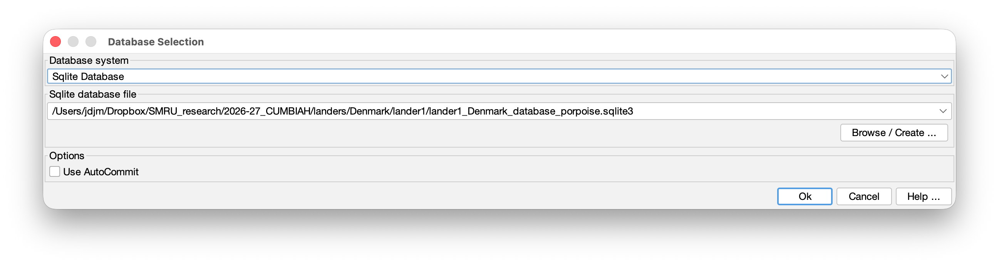
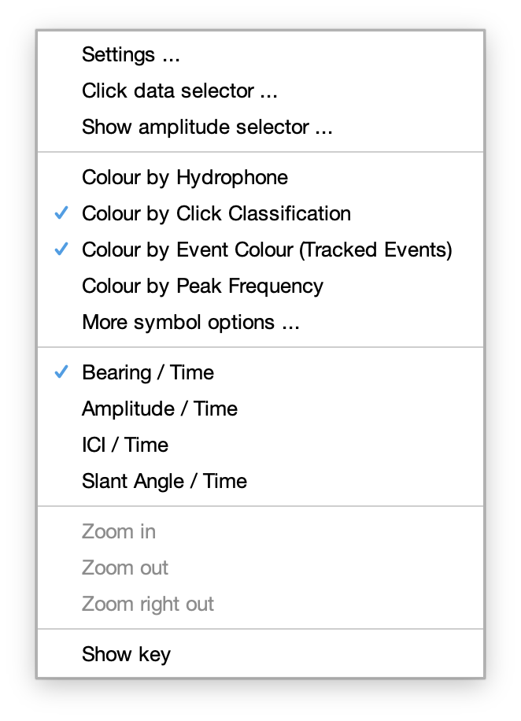
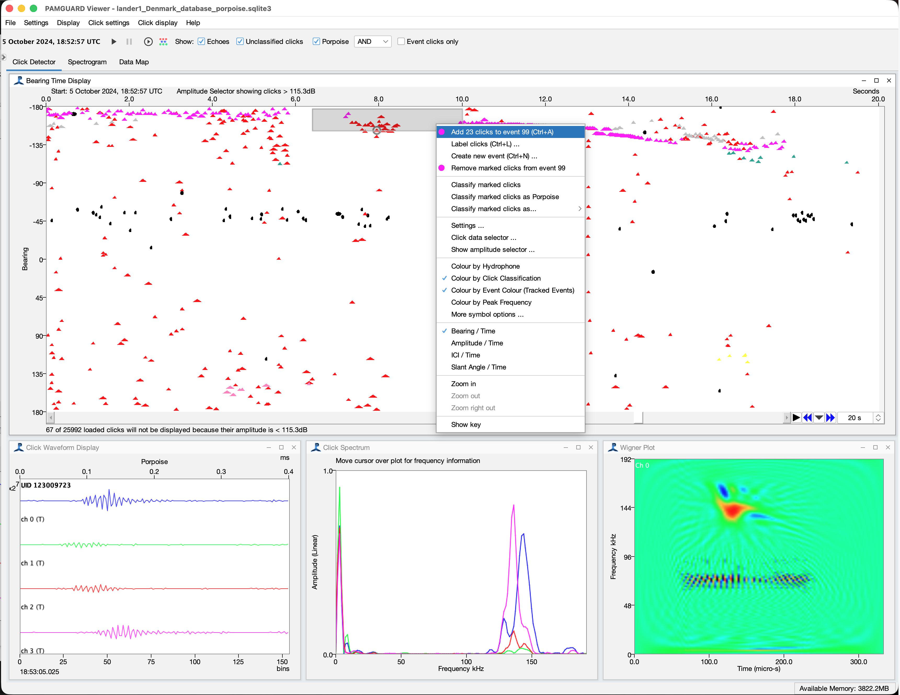
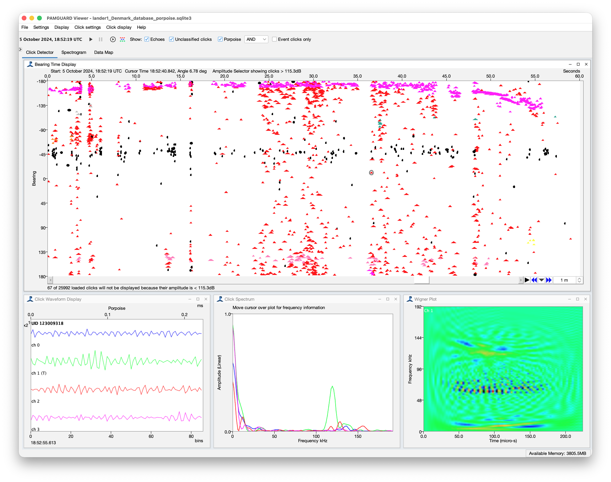

::: {.callout-note appearance="simple"}
|  |  |
|---|---|
| **MATLAB library** | [`cumbiah_landers_mat`](https://github.com/CUMBIAH/cumbiah_landers_mat) |
| **Script used** | `track_porpoises/cumbiah_multitrack.m` |
| **PAMGuard version** | 2.02.18+ (viewer mode) |
| **Event type** | `pp` -- porpoise |
| **Worked example** | Lander 1, deployment 1 (Oct 24), Denmark |
:::

# Introduction

To localise a porpoise we need to know which clicks on a lander came from the same animal. Until now that has meant marking out every click train by hand in PAMGuard, as described in [Tracking Porpoises with PAMGuard](pamguard.qmd#annotating-clicks). With up to nine landers per country and months of data per lander, that is a huge amount of manual work - especially for Denmark where there are loads of porpoises! 

`cumbiah_multitrack.m` marks porposie events automatically and then a user can alter or change the results if needed in PAMGuard. For one lander and one deployment it:

1.  loads every porpoise click from the PAMGuard binary files;
2.  cuts the deployment into **encounters** -- periods with porpoises around, separated by periods with none;
3.  groups the clicks of each encounter into **bearing tracks**, one per animal;
4.  writes every track as a `pp` event into a PAMGuard database, with a **serial number** in the event comment.

The tracks are then ordinary PAMGuard click events. You open the database in viewer mode, look at what the algorithm did, and fix what it got wrong -- which is a _alot_ faster than marking everything out from scratch.

This tutorial covers:

-   how the algorithm works (@sec-how-works);
-   what you need before you start (@sec-prereq);
-   running the script and its settings (@sec-running);
-   how the serial numbers of the events work (@sec-serial);
-   the files the script produces and how to read the diagnostic figure (@sec-output);
-   opening the tracks in PAMGuard and tweaking them (@sec-pamguard);
-   re-running the script without losing your edits (@sec-rerun).

# How the algorithm works {#sec-how-works}

The broad concept of the porpoise multi-track algorithm is fairly simple. Porpoise clicks are notoriously difficult to localise because the narrow band nature of their echolocation clicks, distortion due to the beam profile and echoes all make accurate time delay measurement difficult (if you want to read a really boring paper about this see [here](https://pubs.aip.org/asa/jasa/article/146/4/EL387/995620/Time-of-arrival-difference-estimation-for-narrow)). Clicks on a bearing time display therefore tend to be scattered, rather than the smooth bearing lines a dolphin's broadband clicks will produce. This makes the use of traditional tracking algorithms quite tricky. 

So this algorithm takes a two step approach - first it reduces the problem to something better suited to generic tracking algorithms, uses a tracking algorithm to solve the reduced problem, then assigns raw clicks to tracks. Here's how it works.

::: {.callout-note}
The three steps below are the three panels of the figure the script saves for every encounter (@fig-tracks-simple), so it is worth having that figure in mind while reading. The names in `code font` are settings of `track_bearings`, and the values are the ones `cumbiah_multitrack.m` uses for the landers.
::: 

## Bin and cluster clicks

A single porpoise click bearing can be many degrees out, but a porpoise makes a lot of clicks, and over a second or two it barely moves. So instead of tracking individual clicks, the algorithm first averages them.

**Echoes are removed first.** A click that arrives within 2.5 ms of the click before it (`echoWindow`) is almost certainly a surface or seabed reflection, with a bearing that means nothing. These are flagged and ignored in everything that follows (the red points in the top panel of @fig-tracks-simple). Now and then a real click from a second animal or during a buzz/call is thrown away too, which does little harm.

**Time is cut into short bins.** The encounter is divided into windows of 2 s (`windowLen`). Within one window an animal's bearing is treated as constant.

**The clicks in each bin are clustered by bearing.** In every window a smoothed histogram of the click bearings is made -- a kernel density estimate, with each click spread over a few degrees (`kdeSigma`, 3°). One animal shows up as one bump in that histogram, however scattered its individual clicks are; two animals at different bearings show up as two bumps. Each peak becomes a cluster, as long as it is at least 20% as high as the biggest peak in the window and at least 10° from its neighbour (`peakMinSep`). The histogram is circular, so an animal at ±180° is not split in two.

**Each cluster becomes a *fragment*.** The clicks within 8° of a peak (`fragTol`) are averaged into a single point: a time, a mean bearing, and a standard deviation which says how much that mean bearing can be trusted. A cluster needs at least four clicks (`minFragClicks`) to count, which removes most of the isolated false detections.

The result is that thousands of noisy clicks have been replaced by a few tens or hundreds of fragments (the black points in the top panel), each much more accurate than any click in it, and each with a known uncertainty. That is exactly the kind of data that standard tracking algorithms are designed for.

::: {.callout-note}
## Why a 2 s bin?
The bin is a compromise. Longer bins put more clicks in each fragment and so give better bearings, but an animal whose bearing changes during the bin gets smeared out. The landers do not move, so the bearings are cleaner than on a drifting or moored recorder and a short bin can be used -- which matters, because a porpoise passing close to a lander changes bearing quickly.
:::

## Track the clusters

The fragments now have to be joined up through time into tracks, one per animal. This is the classic multi-target tracking problem, and it is indeed solved in a classic way - no need to for anything too complicated here.

**Each track predicts where it will be next.** Every live track has a Kalman filter which holds two numbers: the animal's current bearing and the rate at which that bearing is changing. From these it predicts the bearing at the time of the next window, along with how uncertain that prediction is. The uncertainty grows the longer a track goes without a fragment.

**Fragments are matched to predictions.** For every pairing of a live track and a fragment in the new window, the algorithm works out how far the fragment is from the track's prediction, measured in standard deviations rather than degrees -- so a fragment 10° off is a poor match for a well established track but a reasonable one for a track that has not been seen for 20 s. Pairings that are too far apart (about 3 standard deviations, or more than 20°) are not allowed. The Hungarian algorithm then picks the set of pairings with the lowest total distance. Doing this for all the tracks at once, rather than letting each track grab its nearest fragment, is what keeps two animals apart when their bearings come close together.

**Tracks are born and die.** A fragment that matches no track starts a new one. A track that gets no fragment for 30 s (`maxGap`) is ended. A track is only kept if it has at least three fragments (`minTrackFrags`), or two fragments with at least 30 clicks between them (`minTrackClicks`), so that a couple of chance clusters of noise do not become an animal.

A single pass like this leaves loose ends, so three tidying steps follow:

-   **Stitching.** Porpoises scan their beam about and can sometimes go quiet, so a single animal is often broken into several tracks. The end of each track is extended forward at the rate its bearing was changing, and if it lands close enough to the start of another track beginning within 60 s (`stitchGap`, `stitchTol`), the two are joined.
-   **Mop-up.** Fragments that were not given to any track are looked at again. One lying close to the line of an existing track is added to it, and the rest are run through the tracker a second time with more generous gaps, to find the weaker tracks the first pass missed.
-   **Click trains.** An animal swimming right past a lander can sweep through tens of degrees in a second or two. That is too fast for the binning: its clicks never share a bearing for a whole window, so they make no fragments. The clicks left over at this point are therefore followed one click at a time, and a run of at least 12 clicks (`trainMinClicks`) with a steadily changing bearing becomes a track. These close passes are the most valuable tracks for the detection function so this step is important. 

The output of this stage is the middle panel of @fig-tracks-simple: fragments joined into numbered, coloured tracks, with the fragments that belong to no track left in grey.

## Assign the clicks to tracks

The tracks so far are made of fragments, but what goes into the PAMGuard database is clicks. The last step goes back to the raw clicks.

Each track is turned into a smooth curve of bearing against time through its fragments. Then every click that was not flagged as an echo is compared with the curves of the tracks that were active at the time of the click, and is given to the closest one -- provided it is within 8° of it (`clickTol`). This includes clicks that were not in any fragment in the first step, because their window was too sparse or because they were a little too far from a peak, so a track usually ends up with more clicks than its fragments had.

Clicks that are not near any track are left unassigned. They are the grey points in the bottom panel of @fig-tracks-simple, and are a mixture of noise, echoes that slipped through, badly measured bearings and animals too faint to follow. Echoes are never assigned to a track.

Each track that has clicks then becomes one event, and gets its serial number (@sec-serial).

::: {.callout-tip}
## What this means when you check the tracks

Each step fails in its own way, and it helps to know which you are looking at when tweaking the tracks in PAMGuard (@sec-pamguard):

-   two animals at nearly the same bearing fall into one cluster in the first step, and come out as **one track**;
-   an animal that is quiet for longer than the stitching allows comes out as **two or more tracks**;
-   good clicks further than `clickTol` from the curve are **left out** of a track, and a few echoes or clicks from another animal close to the curve are **included**.
:::


# Pre-requisites {#sec-prereq}

## Data

This tutorial assumes the lander has already been processed in PAMGuard as described in [Tracking Porpoises with PAMGuard](pamguard.qmd), so that you have:

-   a **binary store** holding the click detections (`Click_Detector_Click_Detector_Clicks_*.pgdf` files), with clicks classified as porpoise and bearings calculated;
-   a **PAMGuard database** (`.sqlite3`) belonging to that binary store.

It also assumes the lander is known to the data management functions `getlanderdeploymentinfo` and `getlanderpaths`, which is how the script finds the binary store and the deployment times from a country, lander number and deployment number. These are described in [Locating the Landers](locatelanders.qmd#data-management).

::: {.callout-note}
## Data management function
Note that these functions are not entirely required but they are convenient - it's trivial to convert the scipt to hardware the inputs as a database and binary folder path. 
:::


::: {.callout-tip}
## Mark the boat calibration first
The cavitation transients of the boat calibration trials are full of clicks that are classified as porpoise. The script leaves out any period covered by a `bc` event, so mark those out first ([Locating the Landers](locatelanders.qmd#sec-pamguard)) or the calibration will turn up as a very busy porpoise encounter.  Note: the location, orientation or position of landers is not known.
:::

## MATLAB libraries

| Requirement | What it is needed for |
|--------------------|----------------------------------------------------|
| [`cumbiah_landers_mat`](https://github.com/CUMBIAH/cumbiah_landers_mat) | The script itself, plus `getlanderdeploymentinfo`, `getlanderpaths` and `getlandersuperfolder` |
| [soundnetloc_mat](https://github.com/Sound-Net/soundnetloc_mat) | The tracking code in `click_train_tracking`: `find_encounters`, `track_bearings`, `plot_bearing_tracks` and `write_track_events` |
| [PAMGuardMatlab](https://github.com/PAMGuard/PAMGuardMatlab) | Reading the clicks from the PAMGuard binary files |
| MATLAB **Database Toolbox** | `sqlite`, used to read and write the PAMGuard database |

## A database for the tracks

The script writes into a PAMGuard database, and it will only write into one you have named yourself. Make a **copy of the lander's database** and give it a name that says what it is for, for example

```
lander1/lander1_Denmark_database.sqlite3   <- your existing database
lander1/lander1_Denmark_database_porpoise.sqlite3    <- copy, for the tracks
```

Working on a copy means the automatic tracks can be deleted and re-written as often as you like without any risk to the events you have already marked by hand. Because it is a copy, it still contains the `bc` events and still belongs to the same binary store.

::: {.callout-warning}
## Close PAMGuard before running the script
Do not have the track database open in PAMGuard while MATLAB is writing to it. Close PAMGuard, run the script, then open PAMGuard again.
:::

# Running `cumbiah_multitrack.m` {#sec-running}

Open `track_porpoises/cumbiah_multitrack.m`. Everything you need to set is in the **Inputs** section at the top.

``` matlab
country      = 'Denmark';
landernumber = 1;
deployment   = 1;

% The PAMGuard database the tracks are written to. It must already exist.
trackdb = '/path/to/lander1/lander1_Denmark_database_porpoise.sqlite3';

writedb    = true;    % write the tracks to trackdb
overwrite  = false;   % false = stop if trackdb already has tracks of this deployment
encounters = [];      % encounters to run, e.g. 3:5; [] = all of them
tlims      = [];      % [start end] datetime to run; [] = the whole deployment
savefigs   = true;    % save a figure of the tracks of each encounter
outfolder  = '';      % results folder; '' = <lander folder>/multitrack
```

Then run the script. The first run of a deployment is slow, because every click file of the deployment has to be read. The clicks are cached in MATLAB's temporary folder, so later runs of the same deployment start in seconds.

The script prints the encounters it found and then works through them:

```
Denmark lander 1, deployment 1: 05-Oct-2024 ... to ...
Loading cached porpoise clicks
... porpoise clicks

62 encounters:
  PP1001  05/10 13:02:10 - 13:20:41   18.5 min     412 clicks
  PP1002  05/10 13:31:55 - 14:30:02   58.1 min   21034 clicks
  PP1003  05/10 14:45:00 - 15:12:00   27.0 min     827 clicks
  ...

--- PP1003: 05-Oct-2024 14:45:00 - 15:12:00 ---
827 clicks, 4 tracks, 301 clicks on a track
Wrote 4 events
```

*(The numbers above are illustrative.)*

## The main input variables

| Setting | What it does |
|-----------------|----------------------------------------------------|
| `trackdb` | The database the tracks are written to. Never chosen for you: if it is empty or does not exist, the script stops. |
| `writedb` | `false` runs the tracking and saves the figures and `.mat` file but leaves the database alone. Use this while you are experimenting with settings. |
| `overwrite` | `false` stops the script before it does any work if `trackdb` already holds tracks of this deployment. `true` **deletes** them and writes new ones -- see @sec-rerun. |
| `encounters` | Run only some encounters, e.g. `3:5`. The numbers are the last three digits of the encounter code (`PP1003` is encounter 3). |
| `tlims` | Restrict the run to a period of the deployment. Leave this as `[]` unless you have a good reason -- see @sec-serial-stable. |

## Encounter settings

Time is cut into minutes. A minute with enough porpoise clicks is *active*, and an encounter is a run of active minutes.

| Setting | Default | Meaning |
|-----------------|-----------|---------------------------------|
| `porptype` | `1` | Click classification flag of a porpoise click |
| `minpermin` | `10` | Clicks in a minute for it to be active |
| `maxgap` | `5` | Minutes with no active minute which end an encounter |
| `encpad` | `1` | Minutes added either side of an encounter |
| `minclicks` | `100` | Encounters with fewer clicks are dropped |
| `maxduration` | `60` | Longer encounters (minutes) are split at their longest silence |
| `boattypes` | `{'bc'}` | Event types of the boat calibration trials, which are left out |
| `boatpad` | `2` | Minutes either side of a boat calibration event also left out |

## Tracking settings

The tracking itself is done by `track_bearings`, and its settings are in `trackargs`. What each stage does is described in @sec-how-works.

The settings you are most likely to change:

| Setting | Default | If you see... |
|-----------------|-----------|---------------------------------|
| `peakMinSep` | `10` | Two animals at similar bearings merged into one track: lower it. One animal split into two parallel tracks: raise it. |
| `maxGap` | `30` | Tracks ending too early in quiet spells: raise it (seconds). |
| `stitchGap`, `stitchTol` | `60`, `20` | One animal broken into many short tracks: raise them. Different animals joined end to end: lower them. |
| `minTrackFrags`, `minTrackClicks` | `3`, `30` | Lots of tiny tracks on noise: raise them. |
| `clickTol` | `8` | Good clicks left grey beside a track: raise it (degrees). Tracks picking up echoes and scatter: lower it. |
| `usevertical` | `false` | Animals at the same bearing but different ranges being merged: set to `true` to track on the vertical angle as well. |

The full list, with defaults, is in `help track_bearings`.

::: {.callout-note}
## Bearings are relative to the lander
The click bearings are left relative to the lander. The lander sits still on the seabed, so its orientation makes no difference to which clicks belong together. The heading, pitch and roll from [Locating the Landers](locatelanders.qmd) are applied later, when the tracks are localised.
:::

# How the serial numbers work {#sec-serial}

Every track is written to the database as a click event of type `pp`, and its serial number -- the *track code* -- is stored in the event's **comment**. A code looks like this:

```
PP1003AB01
```

and reads as follows.

| Part | Example | Meaning |
|-----------|-----------|--------------------------------------------------|
| Species | `PP` | Harbour porpoise (*Phocoena phocoena*) |
| Deployment | `1` | Deployment number: 1, 2 or 3 |
| Encounter | `003` | Encounter number within the deployment, in time order |
| Track | `AB` | Track within the encounter, lettered in time order |
| Fragment | `01` | Always `01` for the CUMBIAH landers |

So `PP1003AB01` is **deployment 1, encounter 3, the second track**.

## Deployment and encounter: the four digits

A lander has a single database and a single binary store for all of its deployments. The deployment therefore has to be part of the code, or encounter 3 of deployment 1 and encounter 3 of deployment 2 would have the same serial number in the same database.

The four digits are simply `1000 × deployment + encounter`:

| Deployment | Encounter codes |
|-----------------|------------------------------|
| 1 (Oct 24) | `PP1001`, `PP1002`, ... `PP1999` |
| 2 (Feb 25) | `PP2001`, `PP2002`, ... `PP2999` |
| 3 (June 25) | `PP3001`, `PP3002`, ... `PP3999` |

Encounters are numbered **in time order**, starting at 1 for each deployment. There is room for 999 encounters in a deployment; if there are more, the script stops and asks you to raise `minpermin` or `minclicks`.

The first six characters, e.g. `PP1003`, are the *encounter code*. Every track in the encounter shares it, and it is also what appears in the names of the figures (@sec-output).

## Track: the two letters

Within an encounter the tracks are sorted by start time and lettered `AA`, `AB`, `AC` ... `AZ`, `BA`, `BB` and so on, which gives room for 676 tracks in an encounter.

| Track | 1st | 2nd | 3rd | ... | 26th | 27th | 28th |
|-------|-----|-----|-----|-----|------|------|------|
| Letters | `AA` | `AB` | `AC` | ... | `AZ` | `BA` | `BB` |

Occasionally a letter is skipped. A track that ended up with no clicks of its own is not written to the database, but it keeps its place in the order, so you may see `AA`, `AB`, `AD` with no `AC`. That is normal.

The event **colour** in PAMGuard is set from the letters too (`AA` = colour 1, `AB` = colour 2 ...), so neighbouring tracks in an encounter are drawn in different colours.

## Fragment: the last two digits

The final `01` is there so that the CUMBIAH codes are the same length as those from other projects which use the same tracking code, where it has a meaning. For the landers it is always `01` and can be ignored.

## Serial numbers are per lander {#sec-serial-landers}

The codes are made separately for each lander. `PP1003AB01` on lander 1 and `PP1003AB01` on lander 2 are **not** the same animal, or even necessarily the same encounter -- lander 2 has its own encounters, numbered from its own clicks. Matching tracks between landers, which is what the [manual annotation standards](pamguard.qmd#manual-annotation-standards) ask for with a shared serial number, is a later step that is not automated yet.

## Keeping the serial numbers stable {#sec-serial-stable}

An encounter's number is just its position in the list of encounters the script found. Anything that changes that list changes the numbers:

-   **`tlims`**. Encounters are numbered within the period that is run. If you run the whole deployment once and then half of it, encounter 3 will not be the same encounter. Leave `tlims = []`.
-   **The encounter settings** (`minpermin`, `maxgap`, `minclicks`, `maxduration`, `encpad`), the click settings (`porptype`, `minamp`) and the boat calibration events all decide where encounters start and end.

Settle these *before* anyone starts editing tracks in PAMGuard, and then leave them alone. The tracking settings in `trackargs` are different: they change the tracks inside an encounter, not the encounters themselves, so they can be adjusted and individual encounters re-run (@sec-rerun).

# What the script produces {#sec-output}

There are three outputs from the script

**Events in the database.** One `pp` event per track in `trackdb`, with the track code in the comment. The `pp` event type is added to the database's lookup table if it is not already there, so that PAMGuard will show the events just like they were annotated by a person. 

**A `.mat` file.** `<lander folder>/multitrack/lander<N>_dep<D>_multitrack.mat` holds a struct `mt` with the settings used and the struct array `mt.encounters`, which has for each encounter its code, time limits, number of clicks, and the tracks and track codes found. This is the record of what the script did, as opposed to the database, which is what you go on to edit.

**A figure for each encounter.** `lander<N>_dep<D>_PPnnnn_tracks.png`, in the same folder, shows the three stages of the tracking.

{#fig-tracks-simple}

The tracks in the figure are numbered in the order the tracker made them, which is usually but not always the order of the letters in the database. In @fig-tracks-simple, tracks 1 to 4 became `PP1003AA01`, `PP1003AB01`, `PP1003AC01` and `PP1003AD01`.

It is worth flicking through these figures before opening PAMGuard. A quiet encounter like @fig-tracks-simple needs little or no attention. A busy one does:

{#fig-tracks-busy}

# Checking and tweaking the tracks in PAMGuard {#sec-pamguard}

The automatic tracks are a starting point. They are written as standard click events precisely so that everything in the *Annotating clicks* section of [Tracking Porpoises with PAMGuard](pamguard.qmd#annotating-clicks) can be used to correct them.

## Opening the track database

Start PAMGuard in **viewer mode**. When asked for the database, select the track database you gave as `trackdb` (e.g. `lander1_Denmark_database_porpoise.sqlite3`) and make sure the binary store is the lander's usual `PAMBinary` folder.

{#fig-pg-open}

## Seeing the tracks

Go to the ***Click Detector*** tab and make sure the clicks are being coloured by event: right click on the bearing time display and check the symbol options, as described in the symbol chooser note at the end of [Tracking Porpoises with PAMGuard](pamguard.qmd).

{#fig-pg-symbols width="450"}

Now navigate to an encounter. The start times are printed by the script and are in the titles of the figures, so pick an encounter, find its time on the ***Data Map***, right click and select ***Centre Data Here***. Each automatic track appears as a run of clicks in one colour, and should look like the bottom panel of that encounter's MATLAB figure.

{#fig-pg-tracks}

## Finding a track by its serial number

The event list shows every event in the database with its type and comment, so the track codes can be read straight off it, and it is the place to edit or delete an event.

{#fig-pg-eventlist}

Right clicking on a coloured click in the bearing time display also shows which event the click belongs to.

## Tweaking the tracks

With the MATLAB figure of the encounter open beside PAMGuard, work through the encounter from left to right. These are the things you will find, and what to do about each.

| What you see | What to do |
|------------------------|-----------------------------------------------|
| Good clicks left out of a track (black or uncoloured clicks lying on the line of a track) | Select them with the area tool and ***Label Clicks*** (*Ctrl+L*), then choose the **existing** event from the list rather than making a new one |
| Clicks in a track that do not belong (echoes, scatter away from the line) | Select them and remove them from the event |
| One animal split into two or more tracks | Select the clicks of the later track and label them into the earlier event. Keep the earlier code |
| Two animals in one track | Select the clicks of one animal and label them as a **new** event, type `pp`, with a new code (see below) |
| A track which is not a porpoise (boat noise, an echosounder, sparse noise) | Delete the event, or change its type if the sound is worth keeping a record of |
| An animal the algorithm missed altogether | Mark it out as a **new** `pp` event with a new code |

{#fig-pg-addclicks}

The aim is the same as for manual annotation: a clean, single line of clicks per animal, with echoes and non-directional clicks removed. As with the calibration transients, do not agonise over single clicks.

## Serial numbers when you edit

The comment is just text, and PAMGuard will let you type anything into it, so a little discipline is needed to keep the codes meaningful.

-   **Leave the code of an event alone when you add or remove clicks.** The code identifies the track, not its exact contents.
-   **When you join two tracks, keep the earlier code** and let the other one go. The gap in the letters does not matter.
-   **A new event needs a new code.** Use the encounter code of the encounter it is in and the next unused letters. If the encounter's last track is `PP1003AD01`, a new track is `PP1003AE01`. Do not re-use the letters of a track you deleted or merged.
-   **Always set the event type to `pp`** for a new porpoise track.
-   **Keep the format exactly**: two capital letters, four digits, two capital letters, `01`, with no spaces. The later analysis reads the code from the comment.


::: {.callout-note}
These rules for edited events are a suggested convention for CUMBIAH rather than something the software enforces. The important thing is that everyone annotating does the same.
:::

When you have finished an encounter it should look something like this, with one colour per animal.

{#fig-pg-tidied}

**Save** before you close PAMGuard (***File \> Save Data***), or the edits are not written to the database.

# Re-running without losing your edits {#sec-rerun}

Once tracks have been edited in PAMGuard, the database holds work that the script cannot recreate. Two settings decide whether a run can overwrite manual annotations. 

| `writedb` | `overwrite` | What happens |
|-----------|-------------|--------------------------------------------------|
| `false` | -- | Nothing is written. Figures and the `.mat` file only. Always safe. |
| `true` | `false` | The script stops straight away if the database already has **any** tracks of this deployment. Safe. |
| `true` | `true` | Old tracks are **deleted, with your edits,** and replaced. |

What `overwrite = true` deletes depends on `encounters`:

-   with `encounters = []` (all of them), every event whose comment starts with `PP<deployment>` is deleted -- the whole deployment, because the encounter numbers may have changed;
-   with a list such as `encounters = 3:5`, only the events of those encounters (`PP1003...`, `PP1004...`, `PP1005...`) are deleted and re-written. The other encounters, and other deployments, are not touched.

Events are matched by their comment, so a new event you made by hand with a code such as `PP1003AE01` is deleted along with the automatic ones. Events of other types, such as `bc`, and events without a `PP...` code in the comment are never deleted.

::: {.callout-warning}
## Set `overwrite = false` once editing has started

Check the value of `overwrite` in your copy of the script before every run -- do not assume it is `false`. With `overwrite = true` and `encounters = []`, a single run replaces every track of the deployment, including all manual corrections. If in doubt, make a copy of the database file first.
:::

A sensible way of working is therefore:

1.  Run the whole deployment with `writedb = false` and look at the figures. Adjust the encounter and tracking settings until the tracks look reasonable across a range of encounters.
2.  Run the whole deployment once with `writedb = true` to write the tracks, then set `overwrite = false`.
3.  Check and tweak the tracks in PAMGuard.
4.  If one encounter has been tracked so badly that it is easier to start again, change `trackargs`, set `encounters` to that encounter alone and `overwrite = true`, run it, and set `overwrite` back to `false` afterwards.

# Troubleshooting

| Problem | Likely cause |
|------------------------|-----------------------------------------------|
| *Set trackdb to the PAMGuard database...* or *The database ... does not exist* | `trackdb` is empty or the path is wrong. The script will not create a database. |
| *N deployment D tracks are already in ...* | The database already has tracks and `overwrite = false`. This is the safety check doing its job -- see @sec-rerun. |
| *No porpoise clicks (type 1) between ...* | Wrong `porptype` for your click classifier, the clicks have not been classified, or `getlanderpaths` is pointing at the wrong binary store. |
| *N encounters, but the track codes only have room for 999* | Too many encounters. Raise `minpermin` or `minclicks`. |
| The boat calibration appears as an encounter | The `bc` events are missing from the database, or have a different event type from `boattypes`. |
| The tracks do not show in PAMGuard | Check you opened `trackdb` and not the original database, and that clicks are coloured by event. |
| The database is locked, or edits vanish | PAMGuard and MATLAB had the database open at the same time. |
| Changed settings but the same clicks load | The click cache is only rebuilt when `tlims`, `porptype` or `minamp` change. Delete the `cumbiah_multitrack` folder in MATLAB's `tempdir` to force a reload, e.g. after reprocessing clicks in PAMGuard. |
