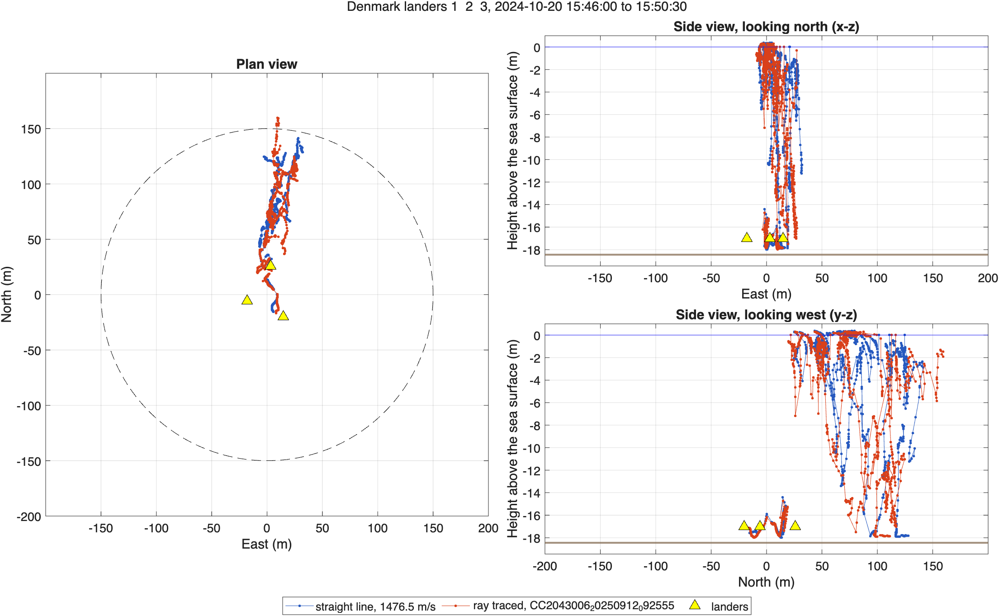

::: {.callout-note appearance="simple"}
|  |  |
|------------------------------------|------------------------------------|
| **MATLAB library** | [`cumbiah_landers_mat`](https://github.com/CUMBIAH/cumbiah_landers_mat) |
| **Scripts used** | `propagation/make_propagation_tables.m`, `propagation/make_propagation_table.m` |
| **Ray tracer** | MATLAB port of BELLHOP in [AcTUP v2.2L](https://cmst.curtin.edu.au/products/underwater/) |
| **Worked example** | Denmark, deployment 1 (Oct 24), SonTek CastAway CTD casts from June and September 2025 |
| **Output** | `<country>/propagation/propagation_tables.mat`, struct array `propagation` |
:::

# Pre-requisites {#sec-prereq}

## Data

- The lander array file from [Locating the Landers](locatelanders.qmd), `lander_array_locations_dep<D>.mat`, for the position of the array and the depth of the landers.
- One or more sound speed profiles taken at or near the array -- ideally during the deployment.

## Software

| Requirement | What it is needed for |
|----------------------|--------------------------------------------------|
| [`cumbiah_landers_mat`](https://github.com/CUMBIAH/cumbiah_landers_mat), with the `propagation` folder | Converting profiles and making the lookup tables |
| [AcTUP v2.2L](https://cmst.curtin.edu.au/products/underwater/) (Acoustic Toolbox User-interface and Post-processor, free from the Centre for Marine Science and Technology, Curtin University). The scripts look for it in `~/MATLAB-Drive/MATLAB/ACTUP`; if you put it somewhere else, pass its folder with the `'actup'` option | Ray tracing. Only its MATLAB BELLHOP files are used, so no compiled Fortran BELLHOP is needed. |

# Introduction

Each lander measures the direction a click arrives from: a horizontal bearing and a **slant** (elevation) angle. Localisation essentially crosses these bearings between landers, and assumes sound travels in straight lines (in reality the localisation algorithm uses time delays but we will refer to bearings here as it's more intuitive). The problem is that sound actually doesn't travel in stright line - it towards water with slower sound speeds, so when the sound speed changes with depth a click from a porpoise near the surface can reach a seabed lander at a quite different angle to the straight line between them.

For the horizontal position this barely matters. For **depth** it matters a lot; great, so we just use 2D distance for distance sampling anyway? Unfortunately because porpoise clicks are inherently difficult to localise (see very boring paper [here](https://pubs.aip.org/asa/jasa/article/146/4/EL387/995620/Time-of-arrival-difference-estimation-for-narrow)) our localisation algorithm contrains the positions so they don't go below the seabed or above the sea surface. If our slant angles are wrong this leads to wrong positions; e.g. over 150 m, a slant error of 5° moves the porpoise by about 13 m vertically.

So how to deal with this? In this tutorial, we will turn sound speed profiles measured at a site into **propagation lookup tables**: for every range and depth around a lander, the slant angle a click really arrives at, worked out by ray tracing with BELLHOP. The localisation algorithm then uses these angles to generate time delay measurements for a particle filter to track animals 3D movements. This tutorial deals only with the propogation modelling - see the [localising porpoises tutorial](localiseporpoises.qmd) for how the propogation is used in localisation.

The workflow is split so that the data source and the physics are kept apart -different groups probably have their own data format but in the end what need is a sound speed profile imported in MATLAB:

```{mermaid}
%%| fig-align: center
flowchart LR
  A["Danish CastAway<br/>.csv casts"] -->|read_castaway| P
  B["German Excel<br/>spreadsheets"] -->|readtable snippet| P
  C["Any other source"] -->|your converter| P
  P(["Sound speed profile<br/>struct (one per cast)"]) -->|make_propagation_table<br/>BELLHOP| T(["Propagation table<br/>struct (one per cast)"])
  T -->|save as struct array| F[("propagation_tables.mat")]
  F -->|localiseporpoises| L["3D porpoise tracks"]
```

Only the first arrow depends on where the data came from. Everything from the **sound speed profile struct** onwards is the same for every country. This tutorial covers:

- the sound speed profile format that every data source is converted to (@sec-svp-format);
- converting the Danish CastAway casts (@sec-danish);
- converting other data, such as Excel spreadsheets (@sec-other);
- ray tracing a profile with BELLHOP to make a lookup table (@sec-bellhop);
- the struct of lookup tables the localisation tutorial needs (@sec-output);
- using the tables in localisation, with the Danish example event (@sec-localise).

::: callout-tip
## Do I need this at all?

If the water column is well mixed (sound speed changes by only a metre or two per second from surface to seabed), refraction is small and straight lines are fine -- see the June results in @sec-bellhop. It matters when there is a thermocline or halocline, and it matters more the further away the porpoise is. Roughly, beyond 80--100 m from the array in a stratified water column. Note that the localisation algorithms accepts a single sound speed as input as well as slant look-up tables.
:::

# The sound speed profile format {#sec-svp-format}

For propogation modeeling we need a **sound speed profile struct**. Whatever format the CTD, raw sound speed data is in, it needs to be converted to he following struct per cast and the rest of the scripts then work without needing altered.

| Field | Type | Units | Description |
|------------------|------------------|------------------|------------------|
| `depth` | column vector | m | Depth below the sea surface, **positive down** and increasing. Not pressure (see the tip below). |
| `c` | column vector, same size as `depth` | m/s | Sound speed at each depth. `NaN` samples are ignored. |
| `time` | `datetime` | UTC | When the profile was measured. Used to choose a table for each encounter. `NaT` if it applies at any time. |
| `file` | char | -- | A name for the profile, e.g. the cast file name. It names the table and appears in the localisation output. |
| `lat`, `lon` | double | decimal degrees | Where the profile was measured. Kept for reference. |

Other fields (temperature, salinity, density...) are allowed and ignored. A struct array holds several casts. This is important of the sound speed profiles change over time.

Example simple profile:

``` matlab
svp.depth = [0 5 10 12 14 17.5]';           % m, positive down
svp.c     = [1488 1488 1487 1481 1477 1476]'; % m/s
svp.time  = datetime(2025, 9, 12, 9, 25, 0); % UTC
svp.file  = 'example_profile';
svp.lat   = 56.0; svp.lon = 10.0;
```

::: callout-tip
## Modelling sound speed profiles

Complex oceanography is beyond the scope of this project but it is likely that sound speeds will need to be modeled based on oceanographic and environmental data - the output of the model needs to be converted to the above format and can then be used the same as everything else.
:::

The ray tracing step does some basic tidying, so the sound speed profile does not need to be on a regular grid or reach the seabed (try to make it as good as possible obviously):

- it is **bin averaged onto a 0.5 m grid** from the surface to the seabed, so instrument noise does not create artificial caustics;
- above the shallowest sample and below the deepest, the sound speed is **held constant** (with a warning if the cast stops more than 1 m short of the seabed).

::: callout-tip
## Common gotchas when converting

- **Pressure, not depth.** Many CTDs record pressure in dbar. In shallow water 1 dbar ≈ 1 m is close enough (the error is about 1%), or use `gsw_z_from_p` from the [TEOS-10 GSW toolbox](https://www.teos-10.org/software.htm) and flip the sign.
- **Down and up casts.** Use the down cast only, or average them -- the ray tracing will average duplicate depths anyway.
- **Time zone.** Make `time` UTC, like the PAMGuard data. If a spreadsheet gives local time, set the `TimeZone` and convert it.
- **Temperature and salinity only.** Compute sound speed with a published equation (see @sec-other). In the brackish Baltic, use an equation valid at low salinity -- TEOS-10 or Chen & Millero / UNESCO -- not Mackenzie (1981), which is only valid above 25 PSU.
:::

# Danish data: CastAway CTD casts {#sec-danish}

In Denmark, sound speed profiles were measured with a **SonTek CastAway CTD**. Every cast is a processed `.csv` export in the country folder:

```         
<Denmark superfolder>/All_SVP_CastAway_Data/CC2043006_20250912_092555.csv
                                            ... (one .csv per cast)
```

Each file has a header of `% key,value` lines (cast time, start latitude and longitude...) followed by a table with depth, temperature, salinity, sound velocity and density. `read_castaway` is the Danish converter: it reads one file and returns a sound speed profile struct (with the extra fields `temp`, `sal` and `density`):

``` matlab
cast = read_castaway(fullfile(svpfolder, 'CC2043006_20250912_092555.csv'));
%   file: 'CC2043006_20250912_092555.csv'
%   time: 12-Sep-2025 09:25:55
%    lat: ...   lon: ...
%  depth: [n x 1 double]   c: [n x 1 double]   temp, sal, density
```

The sound speed is the one the CastAway computes. Duplicate depths are averaged.

There are 29 casts in the Danish folder, from many stations. `load_site_svps` reads all of them and adds each cast's distance from the array, so only those taken at the site are used:

``` matlab
superfolder = getlandersuperfolder('Denmark');
svpfolder   = fullfile(superfolder, 'All_SVP_CastAway_Data');
A = load(fullfile(superfolder, 'lander_array_locations_dep1.mat'));
site  = mean(A.locstable.locationfine, 1);   % [lat lon] of the array

casts = load_site_svps(svpfolder, site);     % every cast, sorted by time
casts = casts([casts.dist] <= 3000);         % those within 3 km of the array
```

Three casts were taken within 0.5 km of the array: two on 25 June 2025 and one on 12 September 2025 (@fig-svp).

{#fig-svp}

::: callout-warning
## No cast from deployment 1

In the example Danish data, no CTD cast was taken during deployment 1 (October 2024), the deployment of the example event used in the localisation tutorial. The closest profiles we have are from the following June and September. We assume that season is important and so use the September cast as the worst case; this is why modelling sound speed profiles is important for each group.
:::

# Other data:  {#sec-other}

Each group will have it's own data format. If dealing with **temperature and salinity but no sound speed** data, then it's easy to write a small converter with the [TEOS-10 GSW toolbox](https://www.teos-10.org/software.htm), which is valid for brackish water:

``` matlab
p  = gsw_p_from_z(-Tk.('Depth (m)'), lat);                 % dbar
SA = gsw_SA_from_SP(Tk.('Salinity (PSU)'), p, lon, lat);   % absolute salinity
CT = gsw_CT_from_t(SA, Tk.('Temperature (°C)'), p);        % conservative temperature
svps(k).c = gsw_sound_speed(SA, CT, p);                    % m/s
```

# Ray tracing with BELLHOP {#sec-bellhop}

## What the ray tracing does

`make_propagation_table` turns one sound speed profile struct into one lookup table. It works by **backwards** rather than tracing rays from every possible porpoise position to the lander, it traces rays *from the lander hydrophone outwards*, and the path from the hydrophone to a point is the path a click takes from that point back to the hydrophone.

1.  The profile is gridded to the seabed (@sec-svp-format) and written as a BELLHOP environment file. It is read back with the AcTUP readers, so the profile is set up exactly as BELLHOP sets it up.
2.  A dense fan of rays, one every 0.02° from −89° to +89°, is traced from the hydrophone with the AcTUP BELLHOP(M) ray tracer (@fig-rays).
3.  For every point of a range × depth grid, the **direct path eigenray** is found: the ray that passes through that point without bouncing off the surface or seabed. The angle it left the hydrophone at is the slant the click arrives from; the time along it is the travel time.
4.  Points no direct ray reaches (a **refraction shadow**) take the angle of the nearest point that has one -- the limiting ray, which is where diffracted sound comes from -- and are flagged in `shadow`.

The profile is assumed to be the same at every range (range independent) and the seabed flat. One table therefore serves every lander of an array at the same depth.

{#fig-rays}

## Running it

For one profile:

``` matlab
P = make_propagation_table(svp, 'hdepth', 17);
```

where `svp` is a sound speed profile struct from any source as described in [The sound speed profile format]. A CastAway `.csv` file name also works and is read with `read_castaway`. The options are:

| Option | Default | Description |
|------------------------|------------------------|------------------------|
| `'hdepth'` | 17 | Depth of the lander hydrophones (m). Set it to the depth of your landers. |
| `'seabed'` | `hdepth + 0.5` | Depth of the seabed (m). |
| `'ranges'` | 0.25 m steps to 20 m, coarser to 1600 m | Horizontal ranges of the table (m). Out to the boat calibration lines of [Locate Landers](locatelanders.qmd). |
| `'depths'` | 0.25 m steps from 0 to the seabed | Source depths of the table (m). |
| `'angles'` | `-89:0.02:89` | Launch angles of the ray fan (deg, positive down). |

A table takes a few minutes to trace.

For a set of profiles, trace each one and keep them together as a struct array. This is the same for every data source:

``` matlab
svps = read_svp_excel('svp_germany.xlsx');      % or read_castaway / load_site_svps
for i = numel(svps):-1:1
    props(i) = make_propagation_table(svps(i), 'hdepth', hdepth);
end
propagation = props;
save(fullfile(superfolder, 'propagation', 'propagation_tables.mat'), 'propagation');
```

For the Danish casts, `make_propagation_tables.m` does all of this in one script. Set the inputs at the top:

``` matlab
country    = 'Denmark';
deployment = 1;
maxdist    = 3000;      % casts within this distance of the array (m)
hdepth     = 17;        % hydrophone depth (m)
overwrite  = true;      % trace a cast again even if its table is saved
```

It finds the casts within `maxdist` of the array with `load_site_svps`, traces each one, and saves each table as `<cast>_propagation.mat` and all of them together as `propagation_tables.mat`, in a `propagation` folder in the country folder.

::: callout-note
`make_propagation_tables.m` reads CastAway files only. For another country, the five-line loop above with your own converter does the same job -- there is no need to change the script.
:::

## What refraction does at the Danish site

@fig-bias compares the ray traced slant with the straight line for the three casts at the array.

- **June** (well mixed): the slant is out by less than 1°, and a straight line localiser would put a porpoise 1--4 m too shallow at 150--250 m. Small next to the bearing noise.
- **September** (thermocline at 10--14 m): the slant is out by 3° at 100 m and 5--6° at 150--200 m. A straight line puts a porpoise 6 m too shallow at 100 m, 14 m at 150 m and 20 m at 200 m -- shallow porpoises get pushed up to the surface beyond about 100 m.

Of the other casts in the folder, those with more than 4 m/s of sound speed change in the top 17 m give depth errors of 1--8 m at 150 m. So it is stratification, not location, that matters.

{#fig-bias}

::: callout-tip
## Checks

- An **isovelocity** profile (constant `c`) should give zero bias everywhere. This checks the tracer and the eigenray search.
- Look at `100*mean(P.shadow(:))`, the percentage of the table in shadow, which `make_propagation_tables.m` prints. Shadows are expected with a strong thermocline (above the turning rays in @fig-rays), but a large shadow in a well mixed profile means something is wrong with the profile -- usually its depth units or sign.
- No direct path arrives below about +0.2° in any Danish profile, so the −10° minimum slant cut-off used in localisation never removes a real click because of refraction.
:::

# The propagation lookup tables {#sec-output}

The output of this tutorial, and the input to localisation, is a **struct array of propagation tables**, one per sound speed profile, saved as the variable `propagation` in the defined `outfolder` e.g.

```         
<country superfolder>/propagation/propagation_tables.mat
```

Each profile con contains the time around when it was measured: the localiser picks the table closest in time to each encounter. Each element has these fields:

| Field | Size | Units | Description |
|------------------|------------------|------------------|------------------|
| `type` | char | -- | `'raytrace'` (or `'straight'`, see below) |
| `time` | datetime | UTC | Time of the profile. Used to pick the table for each encounter. |
| `soundspeed` | scalar | m/s | Sound speed at the hydrophones. The time delays across a lander's hydrophones are computed with it. |
| `meanspeed` | scalar | m/s | Mean sound speed over the water column. |
| `hdepth` | scalar | m | Hydrophone depth the table is for. |
| `seabed` | scalar | m | Seabed depth. |
| `ranges` | 1 × nr | m | Horizontal ranges from the lander. |
| `depths` | 1 × nd | m | Source (porpoise) depths. |
| `slant` | nr × nd | deg, + up | Elevation the click arrives from at the lander. **This is what the localiser uses.** |
| `tau` | nr × nd | s | Travel time along the ray. Stored, but not used at present (see below). |
| `shadow` | nr × nd | logical | True where no direct ray reaches; `slant` and `tau` there come from the nearest point that has one. |
| `z`, `c` | column vectors | m, m/s | The gridded profile that was traced. |
| `source`, `lat`, `lon` |  |  | Name and position of the profile. |
| `created`, `method` |  |  | When and how the table was made. |

::: callout-note
## Why only the slant is used

The hydrophones of one lander are only a few centimetres apart, so over the lander a click is a plane wave. The time delays between its hydrophones are set entirely by the direction the wavefront arrives from - the azimuth (the same as the straight line, since the profile does not change with range) and the refracted slant from the table - and the sound speed at the hydrophones. `propagation_delays` builds the delays this way.
:::

## Choosing a table for each time period

The struct array can mix ray traced tables with **straight line** entries made by `straight_propagation(time, soundspeed)`, for example for a well mixed time of year:

``` matlab
S = load(fullfile(superfolder, 'propagation', 'propagation_tables.mat'));
propagation = S.propagation;
% a well mixed winter: straight lines at 1475 m/s
propagation(end+1) = straight_propagation(datetime(2025, 1, 15), 1475);
```

For each encounter, `select_propagation` picks the entry whose `time` is closest:

- **`'time'`** (default) compares full dates. Use it when profiles were measured during the deployment.
- **`'season'`** compares the time of year and ignores the year. Use it when, as for Danish deployment 1, the profiles come from another year and you assume the water column follows the seasons.

An entry with `time = NaT` is only used if no entry has a time.

# Using the tables in localisation {#sec-localise}

Load the struct array and pass it to `localiseporpoises` (see [Localise Porpoises](localiseporpoises.qmd)):

``` matlab
S = load(fullfile(getlandersuperfolder('Denmark'), 'propagation', 'propagation_tables.mat'));
loctracks = localiseporpoises(landers, arrayfile, ...
    'propagation', S.propagation, 'propagationmatch', 'season');
```

Each localised track records which table was used in `propagation`, and the settings saved with the results list the time, type and source of every table. Without `'propagation'`, the localiser uses straight lines at `'soundspeed'` (1500 m/s by default). The real sound speed at the Danish landers is 1476--1488 m/s, so even straight lines are better with the measured sound speed.

## A Danish example event

The test script `localise_porpoises/_test/test_localise_propagation.m` localises the example event used in the other tutorials -- Denmark landers 1--3, **20 October 2024, 15:46:00--15:50:30** -- twice: once with straight lines at the sound speed at the landers, and once with the ray traced table of the September 2025 cast. Since there is no cast from October 2024, the September cast is used as the worst case. The only difference between the runs is how the time delays are predicted.

{#fig-tracks}

Within about 100 m of the array the two sets of tracks mostly agree in depth to within a few metres. Further out, beyond 110 m, the ray traced depths differ by up to 10--15 m, as @fig-bias predicts. Refraction matters for porpoises beyond roughly 80-100 m in a stratified water column - exactly where the straight line localiser pushes animals up to the surface.

# Assumptions and limitations

- **Range independent profile and flat seabed.** One profile is used for the whole array and out to the edge of the table.
- **One hydrophone depth per table.** A lander at a different depth is looked up as if the porpoise were the same height above it, so keep `hdepth` close to the real lander depth, or make a table per depth.
- **Direct path only.** Surface and seabed echoes are not in the table. Echoes are removed earlier, when tracking (see [Automatic Porpoise Bearing Tracks](multitrack.qmd)).
- **Profiles are snapshots.** A profile measured months from the encounter (as for Danish deployment 1) is a best guess. If profiles from different times give very different tracks, treat depths beyond 100 m with caution.
- **Future work.** The travel times `tau` could be used for time delays between landers, and the ray tracing could be built into the particle filter's location model directly.

# Outputs for next section {#sec-outputs}

| Output | Used in |
|----------------------|--------------------------------------------------|
| `<country superfolder>/propagation/propagation_tables.mat`: the struct array `propagation`, one lookup table per sound speed profile (time period), giving the refracted arrival slant angle and travel time for every porpoise range and depth. The fields are listed in @sec-output. | [Localise Porpoises](localiseporpoises.qmd), passed as `'propagation'` (@sec-localise) |
